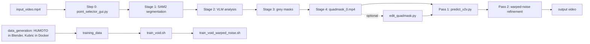

# void-model (VOID, Chappa AI Offline Edition) — Master Design Document
**Version:** 1.0.1
**Status:** Active
**Owner:** chappa.ai LLC
**As of:** 2026-11-15, release `v1.3.0-offline-arm64` (main@e163d2d and later)

## --help
**Document Type:** Master Design Document
**Project:** void-model, the offline ARM64 edition of Netflix's VOID video object and interaction deletion model
**Your task:** Read only the chapter(s) relevant to your assigned work.
**Orchestrator:** If you are coordinating other agents, read §3 (Milestones) and §11 (Agent Orientation) first.
**Sub-agent:** Your task assignment will reference a specific chapter. Navigate there directly.
**Quick Index:** [§1 Overview] [§2 Architecture] [§5 Interfaces] [§7 Security] [§9 Testing] [§11 Agent Rules]

## Table of Contents

| § | Chapter | Summary | Agent hint |
|---|---|---|---|
| §1 | Project Overview | What VOID does, why this edition exists, who uses it. | Everyone: read first. |
| §2 | Architecture | The three pipelines (masks, inference, training data) and the shared model code. | Read before changing code. |
| §3 | Milestones & Roadmap | What shipped and what is next. | Orchestrators. |
| §4 | Component Specifications | Each folder, its entry points and its rules. | Read the subsection for the folder you touch. |
| §5 | API & Interface Contracts | Input folder layout, quadmask values, command-line options, VLM backends. | Anyone changing inputs, outputs or options. |
| §6 | Data Models | Training data layout, checkpoints, dataset metadata. | Training and data-generation work. |
| §7 | Security & Compliance | Supply chain, safe loading, where footage goes, licences. | Every dependency or loader change. |
| §8 | Deployment & Operations | Target hosts, install, releases, the Spark check. | Releases and installs. |
| §9 | Testing Strategy | The test suites and where each one runs. | Every change. |
| §10 | Known Issues & Technical Debt | Open items with their issue numbers. | Before starting new work. |
| §11 | Agent Orientation | Rules for agents in this repo. | Every agent. |
| §12 | Change Log | Versions of this document. | Editors of this document. |

---

## §1 — Project Overview

§1.1 **What.** VOID removes an object from a video together with the effects it has on the scene: shadows and
reflections, and physical interactions such as a held guitar falling once the person holding it is removed. It is
a video inpainting model built on CogVideoX (CogVideoX-Fun V1.5 5B InP), fine-tuned with interaction-aware mask
conditioning (the "quadmask", §5.2). The research and model are by Netflix and INSAIT (arXiv 2604.02296); the
weights are `netflix/void-model` on Hugging Face (`void_pass1.safetensors`, `void_pass2.safetensors`).

§1.2 **Why this edition.** Upstream depends on Google's Gemini API for mask reasoning and on x86 binaries
(decord). This edition (`chappa-ai-llc/void-model`, a fork with upstream's history) runs offline on a DGX Spark
(Linux aarch64, Ubuntu 24.04, CUDA): mask reasoning asks a local Gemma 4 31B server by default, every dependency
installs from standard PyPI wheels, and the stack is security-hardened (§7).

§1.3 **Who.** chappa.ai, and researchers who run video object removal, its training, or its synthetic-data
pipelines on their own GPU hosts.

§1.4 **What it is not.** No hosted service, no web front end, no login. It is a research codebase of
command-line scripts, desktop GUIs (OpenCV/Tk) and one loopback-only Streamlit review tool.

§1.5 **Licence.** Apache License 2.0 (`LICENSE`), as upstream.

---

## §2 — Architecture

§2.1 **Three pipelines on one model package.**



§2.2 **Mask generation** (`VLM-MASK-REASONER/`): the user clicks the object; SAM2 tracks it into a black mask;
a vision-language model looks at frame grids and names the objects the removal affects and how they move; grey
masks mark those regions; stage 4 merges both into `quadmask_0.mp4`.

§2.3 **Inference** (`inference/cogvideox_fun/`): Pass 1 inpaints with the Pass 1 transformer. Pass 2 warps the
Pass 1 result's latents along optical flow and uses them to start a second pass with the Pass 2 transformer, for
better temporal consistency on long clips.

§2.4 **Training data** (`data_generation/`): paired counterfactual videos (with and without the object, plus a
quadmask) from HUMOTO motion capture rendered in Blender with physics, and from Kubric object-launch scenes.

§2.5 **Model package** (`videox_fun/`): CogVideoX transformer and VAE, the inpainting pipelines, datasets and
samplers, utilities. Inherited from VideoX-Fun and trimmed (§10.3).

§2.6 **External pieces not in this repo:** the CogVideoX-Fun base model, VOID checkpoints, SAM2 (pinned commit,
§7.1.4), the VLM server (vLLM by default, §5.4), Blender, Kubric's Docker image, the HUMOTO dataset.

---

## §3 — Milestones & Roadmap

§3.1 **Shipped** (CHANGELOG.md has the detail):

| Version | Date | What |
|---|---|---|
| 1.0.0-offline-arm64 | 2026-04-05 | Fork: offline and ARM64 notes; local VLM backends started in stage 2 but not usable until 1.3.0. |
| 1.1.0 | 2026-11-13 | Security sweep: 82 advisories fixed, safe loading, dead web API and Gradio UI removed. |
| 1.1.1 | 2026-11-13 | Unused reward models removed; Bandit clean at medium and high. |
| 1.2.0 | 2026-11-13 | PyAV replaces decord; Kubric runs in its pinned Docker image. |
| 1.2.1 | 2026-11-13 | Hash lock for the Spark target and `tools/target_check.sh`; Streamlit DNS-rebinding guard. Passed on sparky-1. |
| 1.3.0 | 2026-11-15 | Mask stage 2 fixed and offline by default (local vLLM and Gemma); `openai` pinned (#4). Passed on sparky-1. |

§3.2 **Next** (the BUILD board's timeline is the live copy: https://build.chappa.ai/p/void-model):

- S4, by 2027-02-11: re-assess the Streamlit tool's accepted self-check exceptions (D-01 a, issue #3).
- An end-to-end run of the mask pipeline against a live Gemma server on a Spark (§10.1).

---

## §4 — Component Specifications

§4.1 **`VLM-MASK-REASONER/`**

| File | Role |
|---|---|
| `point_selector_gui.py` | Step 0: click points on the object; writes `*_points.json`. |
| `run_pipeline.sh` | Runs stages 1–4; options `--sam2-checkpoint`, `--device`, `--vlm-backend`, `--vlm-server`, `--vlm-port`, `--vlm-model`. |
| `stage1_sam2_segmentation.py` | SAM2 video propagation; writes `black_mask.mp4`, `first_frame.jpg`. |
| `stage2_vlm_analysis.py` | VLM reasoning over frame grids; writes `vlm_analysis.json`. |
| `vlm_backend.py` | Chooses the VLM server, model and key (§5.4). |
| `stage3a_generate_grey_masks_v2.py` | Grey masks for affected objects (`grey_mask.mp4`); `stage3a_generate_grey_masks.py` is the older version. |
| `stage3b_trajectory_gui.py` | Optional GUI: draw movement paths for objects the VLM marked `needs_trajectory`; writes `trajectory_data.json`. |
| `stage4_combine_masks.py` | Merges into `quadmask_0.mp4`; clears grey from frame 0 (the model was trained that way). |
| `edit_quadmask.py` | Optional mask editor (grid toggles, brush, copy from previous frame, undo). |
| `test_gemini_video.py` | Probe: asks the chosen VLM backend about a few frames. |

§4.2 **`inference/`**: `cogvideox_fun/predict_v2v.py` (Pass 1, `ml_collections` config from
`config/quadmask_cogvideox.py`), `cogvideox_fun/make_warped_noise.py` and
`cogvideox_fun/inference_with_pass1_warped_noise.py` (Pass 2), `pass_2_refine.sh` (batch Pass 2).

§4.3 **`scripts/cogvideox_fun/`**: `train.py` with `train_void.sh` (Pass 1), `train_warped_noise.py` with
`train_void_warped_noise.sh` (Pass 2). Upstream trained on 8× A100 80 GB with DeepSpeed ZeRO stage 2
(`config/zero_stage2_config.json`).

§4.4 **`data_generation/`**: `render_paired_videos_blender_quadmask.py` (HUMOTO renderer, runs inside Blender),
`convert_split_remy_sophie.sh` and `convert_all_scenarios_for_characters.py` (retarget to Mixamo characters),
`kubric_variable_objects.py` (runs in `kubricdockerhub/kubruntu@sha256:a4152c80…`), `physics_config.json`
(static or dynamic per object and sequence), `physics_review_ui.py` (Streamlit review of physics settings, §7.4),
mask conversion helpers. `data_generation/README.md` is the detailed guide.

§4.5 **`videox_fun/`**: `models/` (CogVideoX transformer 3D, VAE), `pipeline/` (CogVideoX-Fun and inpaint
pipelines; `pipeline_wan_fun.py` is known unimportable, §10.3), `data/` (datasets, bucket sampler), `dist/`
(xfuser helpers), `utils/` (including `safe_pickle.py`, `sampler_state.py`, `timeout.py`, `video_reader.py`).

§4.6 **`config/`**: `quadmask_cogvideox.py` (inference defaults: 384×672, 197 frames max, temporal window 85,
50 steps, guidance 1.0, `model_cpu_offload_and_qfloat8`), `default_cogvideox.py`, `default_omnimatte.py`,
`zero_stage2_config.json`.

§4.7 **Other**: `notebook.ipynb` (Colab quick start, Pass 1 on a sample; clones this repo), `sample/` (`lime`,
`moving_ball`, `pillow`), `datasets/void_train_data.json` (training metadata), `tools/target_check.sh` (§8.3).

---

## §5 — API & Interface Contracts

§5.1 **Inference input folder** (one per sequence under a root):

```
data_rootdir/<sequence>/
  input_video.mp4
  quadmask_0.mp4
  prompt.json        # {"bg": "<the scene after removal>"}
```

`bg` describes what remains, never the removal itself.

§5.2 **Quadmask values** (per pixel, per frame):

| Value | Meaning |
|---|---|
| 0 | primary object to remove |
| 63 | overlap of primary and affected |
| 127 | affected region (falls, displacement, shadows) |
| 255 | background, keep |

§5.3 **Outputs.** Pass 1 writes `<save_path>/<sequence>.mp4` and `<sequence>_tuple.mp4` (side by side). Pass 2
writes to `--output_dir` (default `./inference_with_warped_noise`) and caches warped latents in
`--warped_noise_cache_dir` (default `./pass1_warped_noise_cache`).

§5.4 **VLM backends** (`vlm_backend.py`, since 1.3.0). Stage 2 calls an OpenAI-compatible
`/v1/chat/completions` endpoint and expects JSON back.

| `--vlm-backend` | Base URL | Default model | Key | Sent |
|---|---|---|---|---|
| `vllm` (default) | `http://127.0.0.1:8000/v1` | `google/gemma-4-31b-it` | none | frame grids |
| `ollama` | `http://127.0.0.1:11434/v1` | same (pass the Ollama tag) | none | frame grids |
| `llama.cpp` | `http://127.0.0.1:8080/v1` | same (pass the server's name) | none | frame grids |
| `gemini` | Google's OpenAI-compatible endpoint | `gemini-3-pro-preview` | file at `GEMINI_API_KEY_FILE` | frame grids and the whole video |

`--vlm-server` must be a bare host or address (IPv6 is bracketed); `--vlm-port` overrides the port. The 1.2.x
names `--analysis-self-host-type`, `-server`, `-port`, `-model` and `--model` still parse.

§5.5 **Points config** (input to `run_pipeline.sh`): `{"videos": [{"video_path", "output_dir", "instruction",
...points}]}` as written by `point_selector_gui.py`; a bare list is also accepted by stage 2.

---

## §6 — Data Models

§6.1 **Training sequence** (both generators write it):

```
training_data/<sequence>/
  rgb_full.mp4      # with the object
  rgb_removed.mp4   # object removed, physics applied
  mask.mp4          # quadmask 0/63/127/255
  metadata.json
```

`datasets/void_train_data.json` lists the sequences the training scripts read.

§6.2 **Checkpoints.** Transformers as `.safetensors` (preferred) or `torch.load` with `weights_only=True`.
Training resume state is `sampler_pos_start.json`; older `sampler_pos_start.pkl` still resumes, read through
`safe_pickle.safe_load` (§7.2).

§6.3 **HUMOTO input.** Per-sequence `.pkl`, `.fbx`, `.yaml` under `data_generation/humoto_release/`; pickles are
read with `safe_pickle.safe_load` (plain data and NumPy arrays only).

---

## §7 — Security & Compliance

`docs/SECURITY.md` is the detailed reference; this chapter is the summary.

§7.1 **Supply chain.**
- §7.1.1 Every requirement pinned with `==` (`requirements.txt`, `data_generation/requirements.txt`);
  `tests/test_security.py` fails on an unpinned line. Wheels only, from PyPI, no direct URLs.
- §7.1.2 `requirements-lock-linux-aarch64-cp312.txt`: 146 wheels for the Spark target, each with its SHA-256,
  every one checked on OSV.dev (deepspeed left out: source only).
- §7.1.3 A new pin: a release at least two weeks old, 0 OSV advisories, installed through tool-bin `pip-gate`.
- §7.1.4 SAM2 at commit `2b90b9f5ceec907a1c18123530e92e794ad901a4` (no release tags upstream); it loads its
  checkpoint with `weights_only=True`. Kubric by image digest.
- §7.1.5 The BUILD office scans main nightly (OSV and Dependabot); findings become Security rows on the board.

§7.2 **Loading files.** `torch.load(..., weights_only=True)` everywhere; pickles through `safe_pickle.safe_load`;
no `trust_remote_code=True`; no `shell=True`; no `exec` of spliced paths. All enforced by `tests/test_security.py`.

§7.3 **Where footage goes.** Local VLM server by default (§5.4). Google only with `--vlm-backend gemini`, key from
a file. Removed in 1.3.0: the Cloudflare-gateway variant of stage 2 (upstream's private address).

§7.4 **The one web page.** `data_generation/physics_review_ui.py` (Streamlit): loopback only, CORS and XSRF on,
WebSocket Host allow-list `localhost`/`127.0.0.1`, usage statistics off
(`data_generation/.streamlit/config.toml`). Assessed against the Security Self-Check standard
(`security-self-check` `conformance/void-model.toml`); no security headers and no sign-in are accepted
exceptions until 2027-02-11 (D-01 a, issue #3).

§7.5 **Secrets.** None in the repository (gitleaks over the full history, 2026-11-13). The only secret the code
reads is the optional Gemini key, from `GEMINI_API_KEY_FILE`.

§7.6 **Static analysis.** Bandit 1.9.4: 0 high, 0 medium. No CodeQL (it needs GitHub Actions, which chappa.ai
does not use).

§7.7 **Data licences.** HUMOTO needs the authors' approval; Mixamo characters need an Adobe account; neither is
redistributed here. Kubric assets come from Google Scanned Objects at run time.

---

## §8 — Deployment & Operations

§8.1 **Targets.** DGX Spark (sparky-1, NVIDIA GB10, CPython 3.12 on aarch64, CUDA 13) is the reference.
Any CUDA host with Python 3.11 or later works from `requirements.txt` (torch 2.14 and Pillow 13 need 3.11+).
Pass 1 needs a GPU with about 40 GB or more (README: A100 40 GB).

§8.2 **Install.** README "Setup": `pip install -r requirements.txt` (or the hash lock on the Spark), SAM2 at its
pinned commit, the CogVideoX-Fun base model at `./CogVideoX-Fun-V1.5-5b-InP`, VOID checkpoints, and a VLM server
for mask generation (§5.4).

§8.3 **Target check.** `tools/target_check.sh` installs the hash lock into a fresh venv (`--require-hashes
--no-deps --only-binary=:all:`), runs `pip check`, the tests, and a CUDA smoke test, then prints PASS or FAIL.
The BUILD office task `void-model-target-check` runs it on sparky-1 (manual, GPU lease shared 8 GB). It checks
the newest `v*-offline-arm64` tag (approved 2026-11-16). Last pass: run 446 on 2026-11-16, tag
v1.3.0-offline-arm64, 44 tests, CUDA smoke OK on the NVIDIA GB10 (`docs/SECURITY.md`, "Known items left open").

§8.4 **Releases.** CHANGELOG section, then an annotated tag `v<semver>-offline-arm64` on main, pushed. There is
no deployed service and no release recipe in the office's Releases page; a release is the tag. GitHub release
pages: only `v1.0.0-offline-arm64` has one.

§8.5 **No GitHub Actions.** Tests run in the agent pod and on sparky-1.

---

## §9 — Testing Strategy

§9.1 **Suites** (`python -m unittest discover -s tests -v` from the repo root):

| File | What | Needs |
|---|---|---|
| `tests/test_security.py` | Safe loading, no remote code, no exec, every pin `==`. | standard library (NumPy cases skip) |
| `tests/test_vlm_backend.py` | VLM backend defaults, key from file, old option names, stage 2 and `run_pipeline.sh` wiring, `openai` pinned. | standard library |
| `tests/test_smoke_models.py` | Every `videox_fun` module imports; tiny transformer and VAE forward on CPU; PyAV reader matches decord frames. | torch and the pinned stack |

§9.2 **Where.** The pod (x86, CPU) for every change. sparky-1 through §8.3 for dependency changes and releases.
GPU inference with real checkpoints is not automated.

§9.3 **Before a dependency change:** OSV check, the lock regenerated with hashes and checked
(`pip install --dry-run --require-hashes` for the aarch64 cp312 platforms), the suites, then the Spark check.

---

## §10 — Known Issues & Technical Debt

§10.1 **No end-to-end mask run on a live VLM.** Stage 2 against a real Gemma server has not run in CI or on the
Spark; the tests cover the wiring, not the model's JSON. Next: one run on a Spark with vLLM serving
`google/gemma-4-31b-it`.

§10.2 **The pod's dev venv is not the pinned stack.** `scratchpad/venv` is Python 3.13 with numpy 2.5.4 (pinned
1.26.4 has no 3.13 wheel), so `mediapy` fails to import there and `test_every_videox_fun_module_imports` fails
in the pod only. The Spark check (Python 3.12, the lock) is the reference.

§10.3 **Inherited code.** `videox_fun/pipeline/pipeline_wan_fun.py` is unimportable (expects `AutoencoderKLWan`,
not in the repo) and unused. `videox_fun/dist/` xfuser helpers are untested here.

§10.4 **Streamlit exceptions.** No security headers, no sign-in; accepted until 2027-02-11 (issue #3, S4).

§10.5 **SAM2 checkpoint download.** The reasoner README fetches `sam2_hiera_large.pt` without a published
checksum to verify against.

---

## §11 — Agent Orientation

§11.1 **Before work:** the global rules (`~/.claude/CLAUDE.md`), then `build_board.py inbox`, `stale`,
`answered`, `security --phases`, `push`, and `forum.py inbox`. Read the chapter of this MDD for your area.

§11.2 **Chapter map.**

| Role | Read |
|---|---|
| Mask pipeline | §2.2, §4.1, §5.2, §5.4, §7.3 |
| Inference | §2.3, §4.2, §4.6, §5.1–§5.3 |
| Training or data generation | §2.4, §4.3, §4.4, §6, §7.7 |
| Dependencies or security | §7, §9.3, `docs/SECURITY.md` |
| Releases | §8.3, §8.4, CHANGELOG.md |

§11.3 **Sub-agent checklist.** Your brief names the chapter, the files you may change, and the acceptance tests.
Documentation is part of the deliverable: README, `VLM-MASK-REASONER/README.md`, `data_generation/README.md`,
`docs/SECURITY.md`, CHANGELOG.md and this MDD, whichever describe what you change. No new npm, no GitHub
Actions. Work in a branch; the orchestrator merges.

§11.4 **Project rules.**
- §11.4.1 Footage stays local by default. A feature that sends data off the machine is opt-in, documented in
  §7.3 and `docs/SECURITY.md`, with secrets read from `*_FILE`.
- §11.4.2 Pins: §7.1.3. Any change to `requirements.txt` updates the hash lock in the same commit.
- §11.4.3 Loading: never add a `torch.load` without `weights_only=True`, a raw `pickle.load`, or
  `trust_remote_code=True`; the tests will fail.
- §11.4.4 Upstream code is kept close to upstream; fixes are commented where they differ.
- §11.4.5 Handoffs go to the office (`forum.py handoff put`); the scratchpad copy is the fallback.

---

## §12 — Change Log

| Version | Date | Change |
|---|---|---|
| 1.0.1 | 2026-11-16 | §8.3: the target check follows the newest tag; run 446 passed on v1.3.0-offline-arm64. |
| 1.0.0 | 2026-11-15 | First MDD, written from README, `docs/SECURITY.md`, CHANGELOG and the code at release 1.3.0 (BUILD onboarding, docs/build-kickoff.md step 3). |
